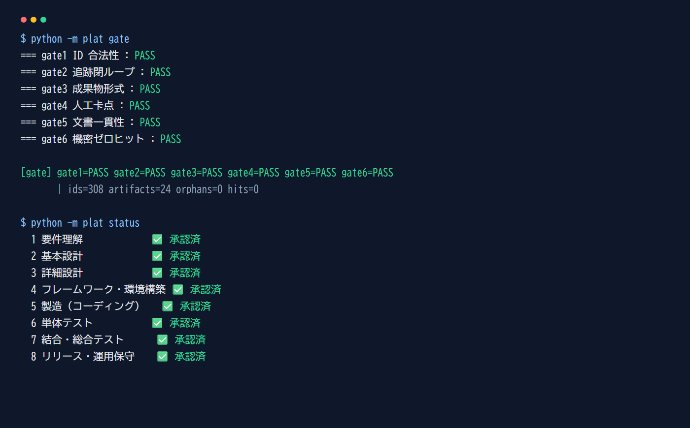
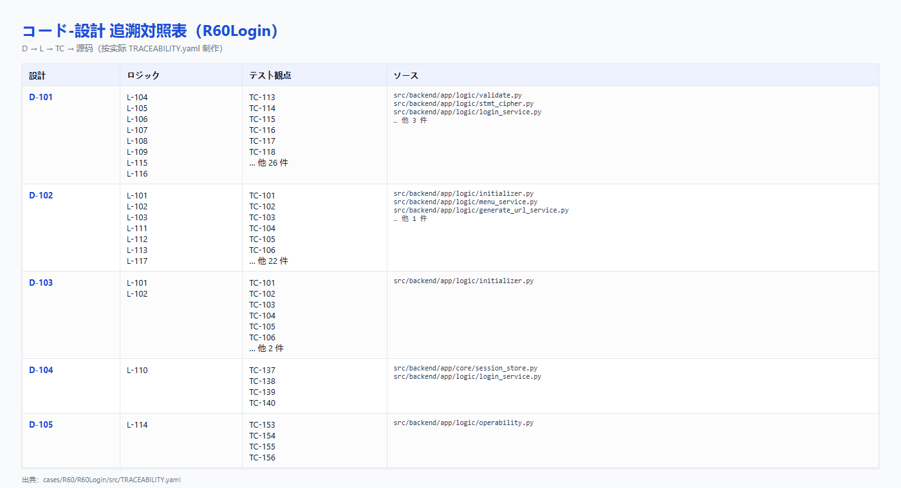
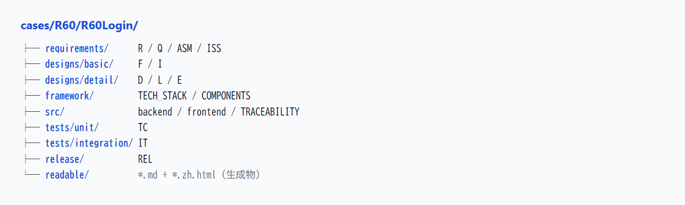
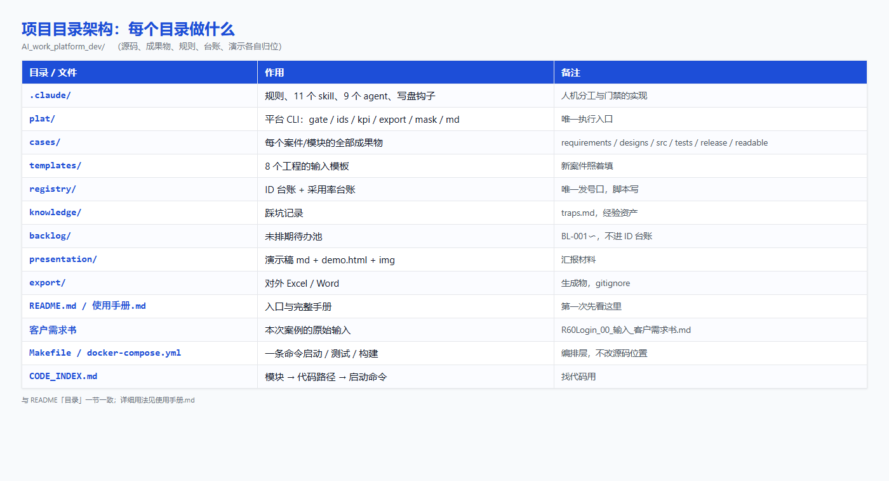
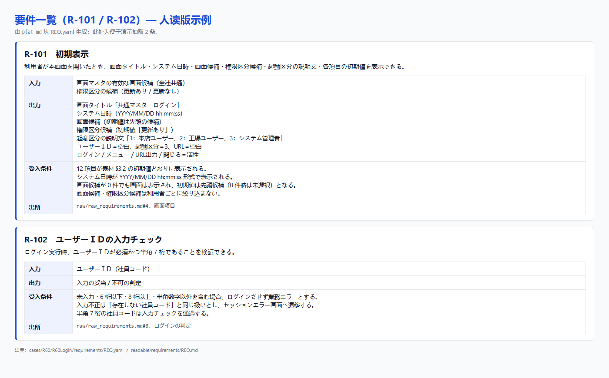
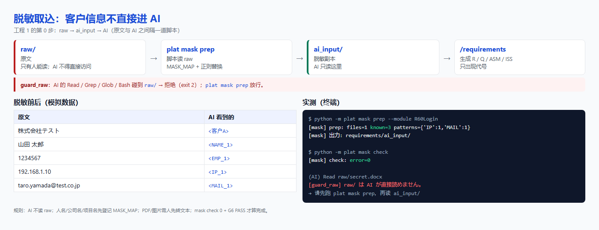
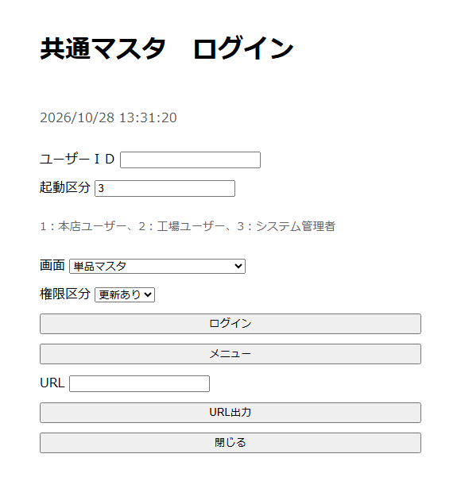
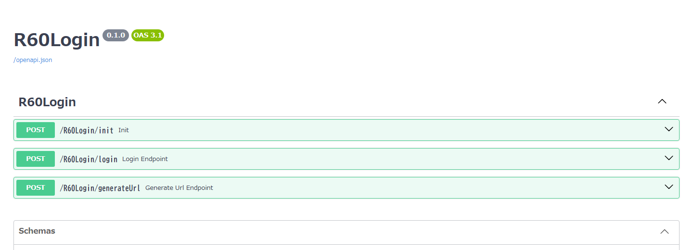
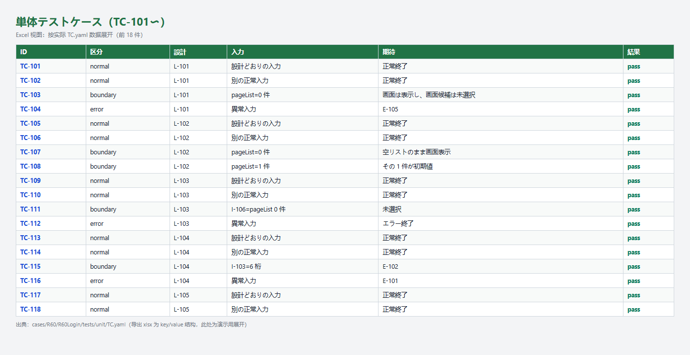

# AI 全链路软件工程平台 — 演示稿（三章版）

> **用法**：本文件是逐页讲稿，可直接粘进 PowerPoint 的分页备注。
> **受众**：公司内部 / 客户。**时长**：40〜50 分钟，含 10 分钟问答。
> **结构**：第一章「是什么、为什么」→ 第二章「怎么用」→ 第三章「还差什么、接下来怎么做」。
> **一条铁律**：本稿每个数字都能用 `python -m plat` 当场复现。**复现不了的不写。**

---

## 第 1 页｜封面

**主张**：AI 执行，人拍板。

- 标题：AI 全链路软件工程平台
- 副标题：8 工程闭环 · 两个模块的实跑报告 · 三章看懂怎么用
- 日期：2026-10

**开场一句话**：今天不讲概念，讲一台已经跑过两个模块的机器，以及你明天怎么用它。

---

## 第 2 页｜目录：三章

| 章 | 回答的问题 | 页数 |
|---|---|---|
| **第一章** | 这个平台是什么？为什么做？解决了什么问题？ | 3〜10 |
| **第二章** | 怎么用？给 AI 什么、AI 给什么、人做什么？ | 11〜23 |
| **第三章** | 还差哪些功能？接下来怎么补？ | 24〜29 |

**讲的时候**：先给听众一张地图，后面每页都知道自己在哪一章。

---

# 第一章｜平台是什么、为什么、解决什么问题

## 第 3 页｜一句话定义 + 三个数字

**主张**：不是一个“更会写代码的 AI”，是一台把 8 个工程串起来的流程机器。

- **不是**：编辑器里的代码补全工具
- **是**：需求 → 设计 → 制造 → 测试 → 发布，8 个工程之间的**交接、承认、追溯、检查**
- **三个数字**（当场可复现）：

| 数字 | 含义 | 命令 |
|---|---|---|
| **308** | 两个模块的 ID 总数，0 个孤立 | `python -m plat gate` |
| **6 / 6** | 六道门全部 PASS | 同上 |
| **24 / 24** | 需求覆盖率 100% | `python -m plat kpi` |

**一句话**：命令是人敲的，活是 AI 干的，检查是机器做的，责任是人担的。

---

## 第 4 页｜为什么需要它：传统 V 模型的四个断点

**主张**：不是人不够努力，是流程按“人驱动”设计的。

| 断点 | 表现 | 本质 |
|---|---|---|
| 严格分层 | 要件→设计→编码→测试，层层交付 | 层层割裂、人工流转 |
| 人力兜底 | 质量取决于参与者经验 | 经验依赖型 |
| 流程固化 | 重文档、重合规、效率低 | 流程合规型 |
| 思维固定 | 人主导，工具只做辅助 | 人力密集型 |

**四类痛点**（对应两份 PPT）：

1. **工具碎片化**：每个阶段用不同 AI 工具，数据不通
2. **上下文断裂**：需求、设计、代码、测试各说各话
3. **产出不可控**：AI 写的东西无审查、无追溯、无度量
4. **安全合规**：代码与数据泄露风险缺乏管控

**结论**：不是用 AI 微调老流程，而是用 AI 重构整个软件工程。

---

## 第 5 页｜核心主张与三条硬约束

**主张**：AI 执行，人拍板。这三条是代码，不是口号。

| # | 约束 | 怎么实现的 |
|---|---|---|
| ① | **人敲命令才能推进** | 11 个 skill 全部设 `disable-model-invocation`。AI 不是“不建议”往下走，是“做不到” |
| ② | **承认只能人填** | `approved_by` 由 `/approve` 写入，必须是人的标识符。AI 写 = 自己批自己 |
| ③ | **机检不过不许往下** | G4：上游成果物没被承认，下游成果物**根本不允许存在** |

**出处**：`.claude/rules/00-platform.md` §4 / §11；`grep -c disable-model-invocation .claude/skills/*/SKILL.md` → 11

**讲的时候**：客户最会问“怎么保证 AI 不跳过评审”。这一页就是答案，可以当场敲给他看。

---

## 第 6 页｜8 工程全链路

**主张**：每个工程是一条人敲下的命令，工程之间是人。

```
要件理解 → 基本设计 → 详细设计 → 框架构筑 → 制造 → 单元测试 → 结合测试 → 发布运维
   ↑人承认     ↑人承认     ↑人承认     ↑人承认    ↑人承认   ↑人承认     ↑人承认     ↑人承认
```

| # | 工程 | 命令 | 主要产出 |
|---|---|---|---|
| 1 | 要件理解（含取込） | `/requirements` | R / Q / ASM / ISS |
| 2 | 基本设计 | `/basic-design` | F / I |
| 3 | 详细设计 | `/detail-design` | D / L / E |
| 4 | 框架・环境构筑 | `/framework` | TECH_STACK / COMPONENTS |
| 5 | 制造 | `/coding` | 源码 + TRACEABILITY |
| 6 | 单元测试 | `/unit-test` | TC |
| 7 | 结合・综合测试 | `/integration-test` | IT + 受入对照 |
| 8 | 发布・运维 | `/release` | REL |

**出处**：`plat/status.py` 的 8 个 STAGE；`python -m plat status`

---

## 第 7 页｜六道门：不用人眼判断的部分

**主张**：机器先查一遍，人只看机器查不出的部分。

| 门 | 查什么 | 失败意味着 |
|---|---|---|
| G1 | ID 合法性：野号、跳号、复用、废号引用 | 台账被绕过 |
| G2 | 追溯闭环：每条需求走得到测试 | 断链、漏测 |
| **G3** | 成果物格式：必填字段、状态值、放置位置 | 机器读不动 |
| **G4** | **人工卡点：上游未承认，下游不许存在** | 跳过评审 |
| G5 | 文档一致性：键名、管理文档登记、手册命令真实存在 | 文档与实现脱节 |
| G6 | 机密零命中：内部 IP、连接串、社内邮箱、密钥形态 | 泄露风险 |

**实际输出**：



**出处**：`python -m plat gate` ／ `python -m plat status`

---

## 第 8 页｜ID 与追溯：一条链，断一环就红

**主张**：需求不是“写完了”，是“能一路走到测试”。

R（要件）→ F（功能）→ I（画面项目）→ D（数据）→ L（逻辑）→ E（错误）→ TC（单测）→ IT（结合）→ REL（发布）

格式 `R-101`；模块按号段区分（登录 `1xx`、厂商 `2xx`）；**308 个 ID，0 个孤立**。



**出处**：`registry/ids.yaml`（唯一发号口）／ `plat gate` G1·G2 ／ `plat impact <ID>`

---

## 第 9 页｜成果物：一个真源，三种读者

**主张**：同一份内容，AI 读 YAML，工程师读 MD，内部评审看中文 HTML，客户拿 Excel。

- **YAML**：唯一真源（AI 与工具）
- **`readable/*.md`**：人读版（日文，由 YAML 生成）
- **`*.zh.html`**：中文外框视图（内部 / 汇报）
- **Excel / Word**：对外正式版（客户）



**数字**：两个模块合计 **30 份人读 MD + 30 份中文 HTML + 24 份对外 Excel**，0 处手工修改。

> **写盘钩子**：每写一个成果物 YAML，自动重生成该模块的人读版；skill 里也写了这一步（双保险）。

**出处**：`plat md` ／ `plat view` ／ `plat export`

---

## 第 10 页｜平台架构：四层 + 项目目录

**主张**：不是示意图，缺任何一层，另外三层都会退化。

**四层**：入口（`README` / `使用手册` / 规则）· 规则（8 工程 / ID / 状态机 / 机密）· 执行（11 skill / 9 agent / 8 模板）· 验证（6 道门 / 写盘钩子 / 采用率）



**和两份 PPT 的 7 层架构对照**：

- **已对齐**：工程别 Agent、ID 台账、成果物仓库、质量门禁、脱敏、KPI
- **还没对齐**：模型网关、RAG 知识库、Web 画面、CI/CD、SSO/审计、成本管理、闭域/GPU
- 第三章会逐条列出来。

**出处**：`plat/` 14 个模块 + `.claude/`

---

# 第二章｜怎么用：给 AI 什么、AI 给什么、人做什么

## 第 11 页｜使用总览：一条命令一个工程

**主张**：不用记 8 套工具，只记“下一步敲哪条命令”。

```
准备素材 → /requirements → /approve → /basic-design → /approve
        → /detail-design → /approve → /framework → /approve
        → /coding → /approve → /unit-test → /approve
        → /integration-test → /approve → /release → /approve
```

**开始一个新模块**：

```bash
python -m plat init --case R60 --module <模块名> --block 100
python -m plat status        # 看现在到哪、下一步敲什么
```

**三条使用规则**：

1. 每个工程产出先是 `draft`，**人不承认，不能进下一工程**
2. 每写一个成果物 YAML，写盘钩子会自动生成 `readable/*.md` + `*.zh.html`
3. 不知道下一步敲什么，就敲 `/next`
4. 门禁 FAIL 时，**停下来查原因**，不要绕过
5. **启动**：本地 `make dev-login-backend` / `make dev-login-frontend`；容器 `make up`（前端 8081 / 后端 8080）

---

## 第 12 页｜你要给 AI 什么 / AI 给你什么（总表）

**主张**：输入越结构化，输出越稳定。

| 工程 | 你要给 AI | AI 给你 | 人做什么 |
|---|---|---|---|
| 1 要件理解 | 日方素材（docx/xlsx/pdf/md）或口头需求 | R / Q / ASM / ISS + 带出处的取込 | 确认粒度、Q 是否该问、ISS 是否阻塞 |
| 2 基本设计 | 已承认的 `REQ.yaml`（含 QST / ASM / ISS） | F / I，每个都挂到 R | 确认 F 的切分、I 有没有多 |
| 3 详细设计 | F / I | D / L / E + 边界值 | 确认排他、异常网罗、消息文面 |
| 4 框架 | D / L | TECH_STACK / COMPONENTS | **拍板技术栈**（承认后不得擅改） |
| 5 制造 | D / L / E + 技术栈 | 源码 + 设计-代码对照表 | 看 extra / unimplemented |
| 6 单元测试 | L / E / 源码 | TC + 执行结果 | 看观点是否够、NG 责任层 |
| 7 结合测试 | TC / 基本设计 / 受入条件 | IT + R↔IT 对照 | 看主线场景、未覆盖理由 |
| 8 发布 | IT / R | Release Note / 手顺 / 切戻し / Runbook | **发布判定**（AI 不判定） |

**缩写对照**：R＝要件 ／ Q＝確認事項 ／ ASM＝前提・仮定 ／ ISS＝未決事項 ／ F＝機能 ／ I＝画面項目 ／ D＝データモデル ／ L＝ロジック ／ E＝エラー ／ TC＝単体テストケース ／ IT＝結合テスト ／ REL＝リリース ／ TECH_STACK＝技術スタック ／ COMPONENTS＝共通部品

> `REQ.yaml` / `QST.yaml` / `ASM.yaml` / `ISS.yaml` 分别是对应类型的 YAML 文件；`R-101`、`F-101` 等是这些类型下的具体 ID。

**每个工程的 YAML 都会自动生成**：`readable/<同路径>.md`（日文）+ `<同名>.zh.html`（中文外框）。

**一句话**：AI 负责“生成初稿 + 自检”，人负责“给标准 + 拍板”。

---

## 第 13 页｜工程 1：要件理解（含取込）

**输入**：`cases/<案件>/<模块>/raw/` 下的 docx / xlsx / pdf / md，或直接贴口头需求。

**命令**：`/requirements`

**AI 给你**：`REQ.yaml` / `QST.yaml` / `ASM.yaml` / `ISS.yaml` + `raw/raw_requirements.md`（本例 R 10 / Q 12 / ASM 8 / ISS 3）



**人要看**：R 是不是“一条能独立验收的要求”；Q 是不是真该问日方；ASM 错了会怎样；ISS 阻塞的是哪个工程。

**承认**：`/approve requirements`

---

## 第 14 页｜工程 1 的前置：脱敏取込（AI 看不到 raw）

**主张**：客户信息不直接进 AI：`raw/` 只有人能读，AI 只读 `ai_input/`。



**四条规则**：
- AI 不得直接读 `raw/`；`guard_raw` 钩子会拒绝 `Read` / `Grep` / `Glob` / `Bash` 的 raw 访问。
- 人名 / 公司名 / 项目名先在 `MASK_MAP` 登记；`plat mask prep` 自动替换。
- IP / 邮箱 / 连接串 / 密钥 / 社員コード等按形态自动替换。
- `mask check` 0 + G6 PASS 才算完成；PDF / 图片需人先转成文本。

**出处**：`plat mask prep` ／ `.claude/hooks/guard_raw.py`

---

## 第 15 页｜工程 2：基本设计

**输入**：已承认的 `REQ.yaml`（限定条件来自 QST / ASM / ISS）。

**命令**：`/basic-design`

**AI 给你**：

| 文件 | 内容 | 本例 |
|---|---|---|
| `designs/basic/FNC.yaml` | 功能 F | F-101〜F-114（14 个） |
| `designs/basic/SCR.yaml` | 画面项目 I | I-101〜I-112（12 个） |



**人要看**：F 能不能独立开发/测试；I 有没有“要件里没有”的字段。

**承认**：`/approve basic-design`

---

## 第 16 页｜工程 3：详细设计

**输入**：已承认的 F / I。

**命令**：`/detail-design`

**AI 给你**：

| 文件 | 内容 | 本例 |
|---|---|---|
| `designs/detail/DSN.yaml` | 数据模型 D | D-101〜D-105（5 个） |
| `designs/detail/LGC.yaml` | 业务逻辑 L（输入/分支/输出/异常/边界值） | L-101〜L-117（17 个） |
| `designs/detail/ERR.yaml` | 错误与消息 E | E-101〜E-111（11 条） |



**人要看**：排他/更新日時（本画面是参照のみ，不需要）；异常系是否网罗；消息有没有技术术语。

**承认**：`/approve detail-design`

---

## 第 17 页｜工程 4：框架・环境构筑

**输入**：详细设计（D 决定 DB，L 决定运行时形态）。

**命令**：`/framework`

**AI 给你**：

| 文件 | 内容 |
|---|---|
| `framework/TECH_STACK.yaml` | 后端/前端/DB/测试/构建/运行命令 |
| `framework/COMPONENTS.yaml` | 共通部品（响应包装、加解密、Session、错误分类等） |

**本例的技术栈**：Python 3.12 / FastAPI / SQLAlchemy Core / oracledb Thin；TypeScript 5 / Vue 3 / Element Plus / Pinia / Vite；Oracle 19c（本画面参照のみ）。

**人要看**：技术选型（**这是本工程唯一真正要拍板的事**）；闭域/机密要求；哪些进共通、哪些留业务。

**承认**：`/approve framework`

---

## 第 18 页｜工程 5：制造（编码）

**输入**：D / L / E + TECH_STACK / COMPONENTS。

**命令**：`/coding`

**AI 给你**：

- **一个 L 一个函数**（便于追溯）
- 后端：`src/backend/app/`（api / core / logic / repository）
- 前端：`src/frontend/src/`（api / stores / views）
- **设计-代码对照表**：`src/TRACEABILITY.yaml`（D → L → TC → 源码）

**怎么读**：

- `traces`：每个 D 对应哪些 L、哪些源码
- `unimplemented`：设计有、代码没有的（要写理由）
- `extra`：代码有、设计没有的（要写理由）

**人要看**：设计没写但代码里有的（补设计还是删代码）；设计写了但代码没有的（本期不做还是漏了）；异常处理落在哪一层。

**承认**：`/approve coding`

---

## 第 19 页｜工程 6：单元测试

**输入**：LGC（分支与边界值）/ ERR（异常）/ 源码。

**命令**：`/unit-test`

**AI 给你**：TC 68 件（正常 / 边界 / 异常），`result` 全填；NG 登记 BUG。



**人要看**：观点是否够；NG 的责任层（设计错 / 实现错 / 测试错）；覆盖率不足的部分是否真的不重要。

**承认**：`/approve unit-test`

---

## 第 20 页｜工程 7：结合・综合测试

**输入**：TC / 基本设计 / REQ 的受入条件。

**命令**：`/integration-test`

**AI 给你**：

| 文件 | 内容 | 本例 |
|---|---|---|
| `tests/integration/IT.yaml` | 业务场景 IT | IT-101〜IT-111（11 个） |
| `acceptance_map` | R ↔ IT 对照 | 10 条 R 全部覆盖 |

**怎么读**：

- 每个场景写“利用者が何をしたくて、どこまで到達するか”，不是接口排列组合
- **每条 R 的受入条件必须至少 1 个 IT 覆盖**
- 覆盖不了的，必须写 `not_covered_reason`，**禁止静默遗漏**
- 非功能（性能/并发/排他）至少列观测点，跑不跑由人决定

**人要看**：主线业务是否覆盖；未覆盖的理由是否诚实；非功能观测点是否够。

**承认**：`/approve integration-test`

---

## 第 21 页｜工程 8：发布・运维

**输入**：IT / R。

**命令**：`/release`

**AI 给你**：

| 内容 | 说明 |
|---|---|
| Release Note | 从 R / F / L 的 ID 自动集约，不手写 |
| 手顺书 | 前提・确认点・スモーク基准（实值用占位） |
| 切戻し | 可执行的步骤 + 目标时间 + **是否演练过** |
| Runbook | 看什么指标、阈值（值由运用决定）、升级路径 |
| 判定条件现状 | 逐条写 met / unmet，**不写“可以发布”** |

**本例**：REL-101；判定条件 3 条 met、2 条 unmet（非功能未跑、顾客确认未做）。

**人要看**：**发布判定本身**（AI 不判定）；切戻し是否可执行、演练过没有；对外物有没有内部 ID / 内部注记。

**承认**：`/approve release`

---

## 第 22 页｜人的操作：承认、问路、变更

**主张**：人不需要记 8 套工具，只需要记 5 个动作。

| 动作 | 命令 | 作用 |
|---|---|---|
| **承认** | `/approve <阶段>` | 把 `draft` 改成 `confirmed`，写入 `approved_by` / `approved_at` |
| **问路** | `/next` | 看现在到哪、下一步敲什么、有没有阻塞 |
| **检查** | `python -m plat gate` | 6 道门一起跑；FAIL 就停下来查原因 |
| **变更** | `/change <ID>` + `plat impact` | 算下游影响面；**退回哪个工程由人决定** |
| **独立复核** | `gate-reviewer` agent | 干净上下文重跑门禁，不信任产出方的说法 |

**三条禁止**：

1. 不要手写 ID、猜号、跳号、复用
2. 不要在 AI 的成果物上直接写 `approved_by`
3. 不要绕过 `plat gate` 提交

---

## 第 23 页｜skill 与 agent 怎么配合 + 一个模块的完整走查

**11 个 skill（人敲的命令）**：`/requirements` `/basic-design` `/detail-design` `/framework` `/coding` `/unit-test` `/integration-test` `/release` `/approve` `/change` `/next`

**9 个 agent（执行体）**：

| agent | 作用 | 什么时候用 |
|---|---|---|
| `stage1`〜`stage8` | 各工程的产出担当 | 想把产出过程隔离在主会话外时 |
| `gate-reviewer` | 独立验证，只列疑点、不判合格 | **承认之前** |

**R60Login 完整走查（实际跑过）**：

| 阶段 | 产出 | 数量 |
|---|---|---|
| 1 要件 | R / Q / ASM / ISS | 10 / 12 / 8 / 3 |
| 2 基本设计 | F / I | 14 / 12 |
| 3 详细设计 | D / L / E | 5 / 17 / 11 |
| 4 框架 | TECH_STACK / COMPONENTS | 2 份 |
| 5 制造 | 源码 + TRACEABILITY | 1 套 |
| 6 单元测试 | TC | 68 |
| 7 结合测试 | IT | 11 |
| 8 发布 | REL | 1 |
| **合计** | **ID** | **172** |

**文件形态**：每步的 YAML 都会自动生成 `readable/*.md` 与 `*.zh.html`；写盘钩子负责兜底。

**怎么跑**：本地 `make dev-login-backend` / `make dev-login-frontend`；容器 `make up`（前端 8081 / 后端 8080）。源码仍在各模块 `src/` 下，根级 `Makefile` / `docker-compose.yml` 只做编排。

**屏幕上的证据行**：`[gate] ... ids=308 artifacts=24 orphans=0 hits=0`

---

# 第三章｜还差什么、接下来怎么做

## 第 24 页｜对照两份 PPT：三层清单

**主张**：主线已经能跑，缺的是“平台基础设施”。

| 层级 | 内容 |
|---|---|
| **已实现（✅）** | 8 工程全链路、人机卡点、ID 台账与追溯、6 道门、成果物三态（YAML/MD/HTML）、Excel/Word 导出、脱敏、变更影响、采用率、覆盖率 KPI、9 个 agent、8 个模板、两套完整案例、**R60Login 可运行的前后端（FastAPI + Vue）+ Makefile / Docker Compose** |
| **部分实现（△）** | Context Hub（只有 ID 台账）、知识层（只有 traps/cases）、治理审计（只有 git + 承认栏）、利用层（CLI + 聊天 + 本地/容器运行；无 Web 平台画面、无 CI/CD）、RACI、成本/工数、测试执行结果、OpenAPI/DDL/脚手架、静态解析 |
| **未实现（❌）** | 模型网关、RAG/向量库、Web 平台画面、CI/CD 集成、SSO/角色权限、审计日志、成本管理、闭域/GPU/认证基盘、专用 IDE 插件、Jira/Redmine 集成 |

**讲的时候**：这一页不要跳。主动摆出未实现，后面的可信度全靠它。

---

## 第 25 页｜未实现的功能要件（按 PPT 的平台层）

| 平台层 | PPT 要求 | 现状 | 缺口 |
|---|---|---|---|
| 利用层 | IDE 插件 / 聊天 / Web / CLI / CI-CD | CLI + 聊天 + 容器化前端 | 无 Web 平台画面、无 CI/CD、无专用插件 |
| 编成层 | 工程别 Agent / 工作流 / Prompt 管理 | 9 agent + 11 skill + 8 模板 | 工作流靠人敲命令；无 Prompt 版本管理 |
| 能力层 | 模型网关 / 代码·文档·测试生成 / RAG / 静态解析 | 生成由 AI 在会话内完成 | **无模型网关、无 RAG、无静态解析集成** |
| 知识层 | 过去案件 / 规范 / 术语词典 / 既存源码 / 设计模式 | traps + cases + rules | 无术语词典、无既存源码索引、无 patterns |
| 数据·上下文层 | Git / 要件 ID / 追溯 DB / 向量 DB | Git + ID 台账 + related_ids | 无 DB、无向量 DB、无 Context Hub 服务 |
| 统制·治理层 | 权限 / 审计 / 脱敏 / 质量评价 / 成本 | 脱敏 + 6 门 + 采用率 | 无 SSO、无审计日志、无成本管理 |
| 基盘层 | 云/本地 / GPU / 闭域 / 认证基盘 | 本地工作站 + Docker Compose | 无 GPU / 闭域 / 认证基盘 |

**出处**：`presentation/` 对照表；`backlog/backlog.yaml`

---

## 第 26 页｜Backlog：22 条，按优先级

**主张**：不一次全铺开，先做“投入小、立刻见效”的。

| 优先级 | 数量 | 做什么 |
|---|---|---|
| **P0** | 6 | 补“能跑起来”的缺口：检索、CI gate、审计日志、术语词典、静态解析、测试执行 |
| **P1** | 10 | 平台能力/治理：OpenAPI/DDL、脚手架、模型网关、SSO、Context Hub、成本、IF/NFR、RACI、工数基线、RAG 向量库 |
| **P2** | 6 | 平台化/全社展开：Web 画面、IDE 插件、Jira/Redmine/Excel、闭域部署、多案件 KPI、Excel 回写 |

**P0 六条**：

| ID | 内容 | 大小 |
|---|---|---|
| BL-001 | `plat search` 最小版（全文/关键词检索） | M |
| BL-002 | CI 中强制执行 `plat gate` | S |
| BL-003 | 审计日志（谁生成/谁修改/谁承认） | M |
| BL-004 | 术语词典与 `patterns.md` | S |
| BL-005 | 静态解析集成（ruff/eslint/bandit） | M |
| BL-006 | 测试执行与覆盖率回填 | L |

**升格规则**：`BL-xxx` 只是候选；人确认要做后，走 `plat ids alloc --type CR` 升格为 CR，不直接当成果物 ID 用。

**出处**：`backlog/backlog.yaml`

---

## 第 27 页｜落地路线：Phase 1 / 2 / 3

**主张**：每阶段确认“可测量的成果”再进入下一阶段，不一次全铺开。

| 阶段 | 做什么 | 验收标准 |
|---|---|---|
| **Phase 1**（现在） | 搭平台，选 1 个案件 1 个模块跑通 8 工程，并做到可本地/容器启动 | 6 道门常绿 + 一条需求能追到测试 + 24/24 覆盖 + 后端可启动 / 前端可构建 |
| **Phase 2**（3〜6 个月） | 补 P0/P1：RAG、CI、审计、SSO、模型网关、OpenAPI/DDL | 新模块能独立走完，不需平台方陪同 |
| **Phase 3**（6〜12 个月） | 补 P2：Web、IDE 插件、闭域、多案件 KPI | 多案件并行，知识沉淀复用 |

**和两份 PPT 的对应**：

- PPT 的 Phase 1「基盘准备 + 1 案件全工程」= 本平台现在的位置
- PPT 的 Phase 2「全工程展开 + 模板落地」= P0/P1 补齐
- PPT 的 Phase 3「平台化 + 全社展开」= P2 + 组织推广

---

## 第 28 页｜已知边界（主动摆出来）

**主张**：没跑就说没跑，没做就说没做。

| # | 没做到的事 | 现状 |
|---|---|---|
| 1 | 结合测试真实执行 | R60Login 10 个场景为【模拟】pass，IT-111（非功能）`not_run`；无浏览器/Oracle 实机 |
| 2 | 单测真实执行 | R60Login 68 件结果标【模拟】pass；源码已有，但未在 CI 里真跑 |
| 3 | 日方真实回答 | Q-101〜Q-112、ISS-101〜103 全是【模拟】；暗号方式、Session 有效期、mngInfo 也是模拟 |
| 4 | 顾客确认 | Q-111 / ISS-101 / ISS-102 的实顾客确认未做 |
| 5 | 采用率样本 | R60Login 43.9%（含模拟回答导致的修正，**不是人的修正率**）；R60Maker 93.1% |
| 6 | 人月削减率 | **没有实测数据**，本稿不放百分比 |
| 7 | 知识库检索（RAG） | 只留目录与空命令，**未实现** |
| 8 | 平台基础设施 | 模型网关、CI、SSO、审计、成本、闭域均未做（见第三章） |

**出处**：各模块 `REL.yaml` 的 `criteria`；`src/TRACEABILITY.yaml` 的 `unimplemented`；`backlog/backlog.yaml`

**讲的时候**：这一页不要跳。跳过它，前面所有数字都会被怀疑。

---

## 第 29 页｜下一步 90 天 + 一句话

**主张**：先补 6 个 P0，再谈全社展开。

**90 天三件事**：

1. **CI 里跑 6 道门**（BL-002）：未通过不可合并
2. **补审计与检索**（BL-001 / BL-003）：谁改了什么、知识能搜到
3. **真跑单测**（BL-006）：把【模拟】pass 换成真实执行结果

**建议的试点**：选一个真实案件的一个模块，按 Phase 1 跑一遍；两周内给三样东西：

1. 6 道门的状态
2. 一条需求的完整追溯
3. 该模块的初稿采用率（标明样本量与是否含模拟）

**收尾一句话**：

> **命令是人敲的，活是 AI 干的，检查是机器做的，责任是人担的。**

---

## 第 30 页｜附录：数字与命令对照

| 数字 / 事实 | 命令 |
|---|---|
| 308 个 ID / 24 成果物 / 6 道门 | `python -m plat gate` |
| 8 工程进度 | `python -m plat status` |
| KPI 六维 / 采用率 | `python -m plat kpi` ・ `python -m plat adopt --module <模块>` |
| 24 份对外 Excel | `python -m plat export --case R60 --module <模块>` |
| 人读 MD / 中文 HTML | `python -m plat md --module <模块> --html` |
| 本地启动 / 容器启动 | `make dev-login-backend` / `make dev-login-frontend` / `make up` |
| 前端构建 | `make build` |
| 变更影响面 | `python -m plat impact <ID>` |
| 机密检查 0 件 | `python -m plat mask check` |
| 11 条踩坑 | `knowledge/traps.md` |
| 待办池 | `backlog/backlog.yaml` |

**收尾话术**：这一页不是附录，是保险——「在座哪位对哪个数字有疑问，我现在就可以跑给他看。」

---

## 附：可能被问到的问题（预备答案）

| 问题 | 答 |
|---|---|
| AI 写的代码质量怎么保证？ | 三道：6 道门机械检查、单元测试、人做合否判定。而且**没跑过的测试标注为 not_run / 【模拟】，不冒充真实通过**。 |
| 客户资料会不会外泄？ | 原始素材不入库；成果物只写代号；有专门的机密形态扫描（G6）+ `plat mask`。 |
| 会不会取代工程师？ | 取代的是“打字”和“抄写”。定标准、验结果、担责任这三件事，仍然是人。 |
| 和 Copilot / Cursor 有什么区别？ | 那些是编辑器里的补全工具；这套是**流程机器**——管的是 8 个工程之间的交接、承认和追溯。 |
| 现在能用吗？ | 主线可用：8 工程、6 道门、ID 追溯、成果物三态（YAML/MD/HTML）都已跑通。缺的是平台基础设施（RAG、CI、SSO、审计），见第三章。 |
| 为什么不直接上大平台？ | 先跑通一个小项目的全链路，再按 P0→P1→P2 补。一次全铺开，失败成本最高。 |
| 采用率为什么有 43.9% 和 93.1%？ | R60Login 含【模拟】回答与重做，43.9% 是“初稿到承认版的修正量”；R60Maker 是前次较完整的实跑，93.1%。两者都不是“人的修正率”。 |
| 怎么启动/部署？ | 本地 `make dev-login-backend` + `make dev-login-frontend`；容器 `make up`。源码仍在各模块 `src/` 下，根级 Makefile / Compose 只做编排，不改变追溯。 |
